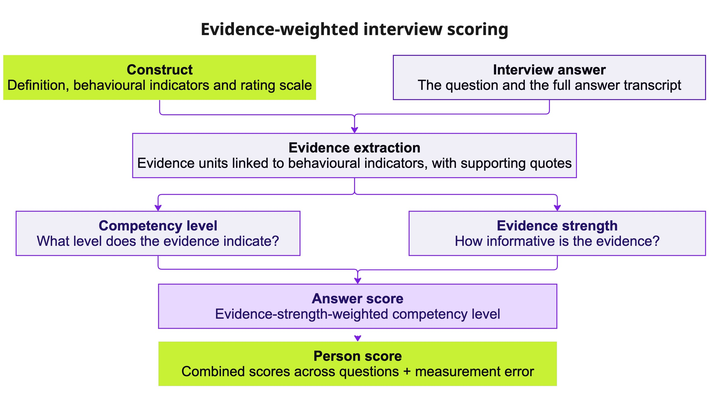

# Evidence-weighted interview scoring

An interview answer usually receives one rating per competency, and the rating does not show what it rests on. The
evidence-weighted scorer extracts the pieces of evidence in the answer, rates each piece twice (the level of the
competency it shows, and how informative it is), and combines them into the answer score. Every score is linked to the
quotes behind it.

This summary describes the pipeline and its run on **problem solving** in RecruitView video interviews (1,885 answers,
328 persons, 76 questions), next to a **zero-shot rating** of the whole answer that uses the same definition and
rating scale. All scores are produced by language models from the answer transcripts.

## Results

- **The two methods order persons the same way.** On the 610 answers both methods score, the person x method variance
  is 0.002 [0.000, 0.035] and the person effects of the two methods correlate at 1.00 [.85, 1.00]. Single answers
  agree less (Spearman .56). Both methods are judgments of the same model (`gpt-4.1`) with the same definition and
  rating scale, so the agreement stays within one model and does not check the scale independently.
- **Only the evidence-weighted score shows why.** Each answer score is a weighted mean of rated quotes. The extracted
  evidence also explains the zero-shot rating: with the evidence of each answer in the model, the person variance of
  the zero-shot rating falls from 0.266 to 0.023.
- **It depends less on answer length.** On the 610 answers both methods score, the Spearman correlation with answer
  length is .18 for the evidence-weighted score and .34 for the zero-shot rating.
- **Costs.** Evidence exists in 37% of answers; most scored answers rest on one unit; on its own the evidence-weighted
  score is less reliable than the zero-shot rating (E-rho2 at 6 questions .57 against .80).

## Pipeline

| Step | What it does | Model |
|---|---|---|
| 1. Extraction | Finds the units of evidence of the competency or its ineffective pole, each with verbatim quotes. A unit is one specific past occasion (episode), one regular practice (routine) or one general self-description (claim), labelled with the behavioural categories it shows. | `gpt-4.1` |
| 2. Filter | Drops units without a behavioural category. | |
| 3. Manifestation | Rates the level of the competency each unit shows, 1 to 5 on the behaviourally anchored rating scale (BARS) of Stockdale, Hickman and Liu (2026); 0 = not estimable. Sees only the question and the unit's quotes. | `gpt-4.1` |
| 4. Evidence check | Units rated 1: evidence of the competency (kept) or other content (level set to 0). | `gpt-4.1` |
| 5. Signal strength | Rates how informative each unit is, 0 to 5, from the quality of the report (specific situation, own action, stated result) and how typical the act is for the competency; 0 = not evidence. Does not see the level. | `gpt-4.1-mini` |
| 6. Answer score | Strength-weighted mean of the unit levels: sum(strength x level) / sum(strength), over units with strength and level above 0. | |

The zero-shot rating reads the question and the full answer and returns one number, 1 to 5 (0 = not estimable), with
the same definition, behavioural categories and BARS (the Def-BARS-1 prompt of Stockdale et al., 2026). All prompts
are in [`prompts/`](prompts/).

## Manifestation and signal strength

Two pieces of problem-solving evidence (illustrative):

- "Our releases kept failing. I traced it to a config mismatch, fixed it and added a check so it would not happen
  again."
- "We had some issues with our releases, and I helped resolve them."

Both may point to a good level of problem solving. The first shows the problem, the action and the prevention; the
second is too thin to rate the level with confidence. Manifestation is the level; signal strength is how much the
unit can tell. Weak evidence is not a low level.

In the run, level 3 occurs at every strength, and the unit types differ in strength more than in level:

| Signal strength | Level 1 | Level 2 | Level 3 | Level 4 | Level 5 | Units |
|---|---|---|---|---|---|---|
| 1 | 19 | 30 | 81 | 1 | 2 | 133 |
| 2 | 22 | 39 | 172 | 5 | 3 | 241 |
| 3 | 7 | 15 | 116 | 4 | 2 | 144 |
| 4 | 0 | 4 | 107 | 13 | 5 | 129 |
| 5 | 1 | 3 | 68 | 18 | 32 | 122 |

| Unit type | Units | Mean level | Mean strength |
|---|---|---|---|
| Episode | 503 | 3.00 | 3.41 |
| Routine | 151 | 2.97 | 1.97 |
| Claim | 115 | 2.54 | 1.37 |

*Note.* 769 units with strength and level above 0.

One answer through every step, for problem solving and for conscientiousness: [`example_answer.md`](example_answer.md).

## Problem-solving run

- Extraction on all 1,885 answers: 1,492 units in 1,290 answers; 1,094 with a behavioural category (episode 612,
  routine 214, claim 268).
- After manifestation, evidence check and strength: **769 units in 703 answers of 273 persons** enter a score. 386
  answers have a unit of strength 3 or more; 648 answers rest on one unit.
- Zero-shot rating: 733 answers rated 1 to 5, 1,152 rated 0 (not estimable).

## Zero-shot and evidence-weighted

**Which answers get a score.** 610 answers have both scores. The zero-shot method rated 123 answers that have no
evidence unit (mostly at 1) and gave 0 to 93 answers that have one.

**Zero-shot rating against the highest unit level of the answer** (all 1,885 answers):

| Zero-shot | No unit | 1 | 2 | 3 | 4 | 5 |
|---|---|---|---|---|---|---|
| 0 | 1,059 | 9 | 23 | 59 | 2 | 0 |
| 1 | 112 | 28 | 36 | 73 | 0 | 0 |
| 2 | 10 | 4 | 21 | 185 | 1 | 1 |
| 3 | 1 | 0 | 0 | 182 | 35 | 31 |
| 4 | 0 | 0 | 0 | 0 | 2 | 10 |
| 5 | 0 | 0 | 0 | 0 | 0 | 1 |

*Note.* Spearman .60 on the 610 answers with both.

**Ordering of persons.** In a G-study of the 610 answers (person x question x method, scores standardized within
method), person variance is 0.273 [0.181, 0.359] and person x method 0.002 [0.000, 0.035]. Person effects of the two
methods correlate at 1.00 [.85, 1.00]. The manifestation stage and the zero-shot rating use the same model and the same
BARS, so the agreement does not test the definition itself. Details:
[`03_problem_solving_gtheory`](../03_problem_solving_gtheory/).

**What explains the zero-shot rating** (733 answers, person and question random):

| Predictors of the zero-shot rating | Length coefficient (SE) | Person variance |
|---|---|---|
| none | | 0.266 |
| answer length | 0.42 (0.04) | 0.175 |
| + evidence present, number of units, sum of strength | 0.19 (0.03) | 0.051 |
| + evidence level | 0.16 (0.03) | 0.023 |

*Note.* Length = z of log tokens. In the full model, evidence level 0.39 (SE 0.03), sum of strength 0.23 (SE 0.02).

**Answer length.** On the 610 answers both methods score, Spearman with answer length: zero-shot .34,
evidence-weighted .18. On all scored answers: zero-shot .40 (733 answers), evidence-weighted .17 (703 answers); for the
evidence-weighted score the length coefficient is 0.19 (SE 0.04) and the person variance 0.107 without and 0.091 with
length.

## Costs of the evidence-weighted score

- **Coverage.** A score exists only where the answer contains evidence: 703 of 1,885 answers (37%), 273 of 328
  persons.
- **Coarseness.** 648 of 703 scored answers rest on one unit, so the score equals that unit's level; 69% of the scores
  are exactly 3.
- **Reliability on its own.** Person-level G-study, each method on all its answers: E-rho2 at 6 questions .57 for the
  evidence-weighted score (273 persons) and .80 for the zero-shot rating (288 persons). On the 610 common answers: .60
  [.42, .71] against .77 [.66, .82]. Averaging the two methods: .78 [.67, .83].

## Related

- Question activation and what the score measures: [`03_problem_solving_gtheory`](../03_problem_solving_gtheory/).
- Conscientiousness: prompts only; the evidence-weighted run is not complete.

## References

Gupta, A. K., Sheth, F., Shaikh, H., Kumar, D., Puniya, A., Panwar, D., Chaurasia, S., & Mathur, P. (2025).
*RecruitView: A multimodal dataset for predicting personality and interview performance for human resources
applications* (arXiv:2512.00450). arXiv. https://arxiv.org/abs/2512.00450

Stockdale, K., Hickman, L., & Liu, S. (2026). Scoring employment interviews with large language models: Evaluation
design components, validity investigations, and best practice recommendations. *Journal of Applied Psychology*.
Advance online publication. https://doi.org/10.1037/apl0001396
