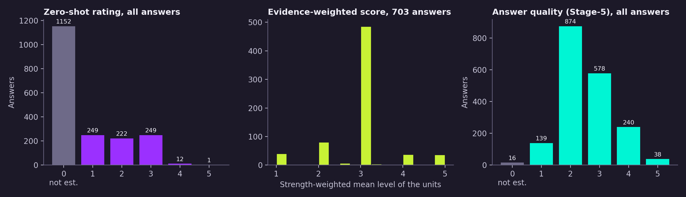
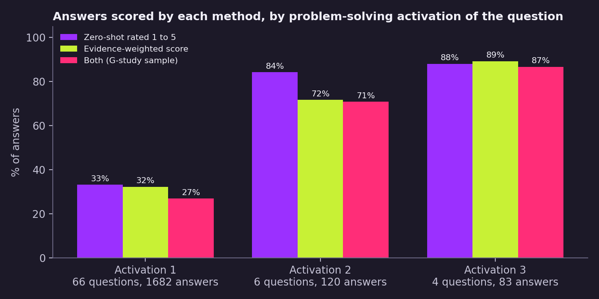
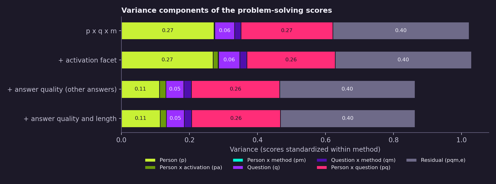
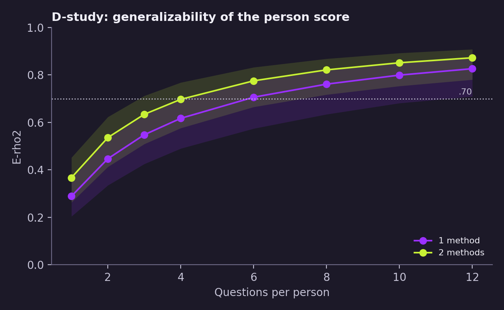
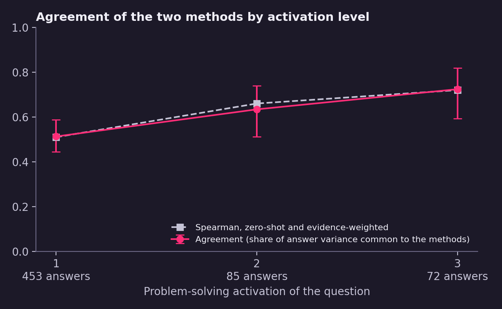
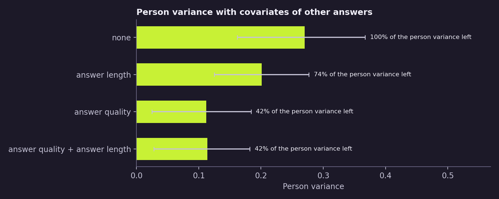

# Problem-solving scores of video-interview answers: variance components, question activation and answer quality

Generalizability study of two language-model scores of problem solving given to the same RecruitView answers: a
zero-shot rating of the whole answer and an evidence-weighted answer score. The study estimates the share of score
variance that belongs to the person, whether the two methods order persons the same way, how agreement depends on the
problem-solving activation of the question, and how much of the person variance the answer quality and answer length of
the person's other answers account for.

## Summary

- G-study sample: 610 answers of 265 persons to 61 questions, scored by both methods.
- Person variance is 26.7% of the total score variance (0.273 [0.181, 0.359]); person x method is 0.2% (0.002
  [0.000, 0.035]). The two methods order persons the same way; both are `gpt-4.1` judgments with the same BARS
  (section 6).
- Problem-solving activation of the question as a facet: person x activation 0.014 [0.000, 0.126]; the person component
  is unchanged (0.270). The data show no person x activation effect and cannot exclude a moderate one.
- Agreement of the two methods on an answer rises with activation: .51 [.44, .59], .63 [.51, .74] and .72 [.59, .82]
  at activation 1, 2 and 3. The residual (disagreement between methods) stays the same; the variance of the answer
  score grows.
- E-rho2 of a person score from one method reaches .71 [.57, .77] at 6 answers that both methods can score and .83
  [.71, .87] at 12.
- The answer quality of the person's other answers leaves 42% [8%, 64%] of the person variance; answer length leaves
  74% [51%, 89%]; both together 42% [11%, 61%] (person-cluster intervals).
- At activation 1, the zero-shot rating depends more on the answer quality of the other answers than the
  evidence-weighted score (difference 0.13 per SD, SE 0.04); at activation 2 and 3 the two are equal.

## 1. Data

RecruitView (Gupta et al., 2025): asynchronous video interviews in English. Analysis sample: 1,885 answers of 328
persons to 76 questions, after removing retakes and answers of 5 tokens or fewer. All scores in this study are produced
by language models from the answer transcript.

G-study sample: answers with a zero-shot rating of 1 to 5 and an evidence-weighted score.

**Table 1.** Sample by problem-solving activation of the question

| Activation | Questions | Answers | Zero-shot rated 1 to 5 | Evidence-weighted score | Both (G-study) | Persons | Persons with 2+ answers |
|---|---|---|---|---|---|---|---|
| 1 | 66 | 1,682 | 559 (33.2%) | 543 (32.3%) | 453 (26.9%) | 225 | 144 |
| 2 | 6 | 120 | 101 (84.2%) | 86 (71.7%) | 85 (70.8%) | 85 | 0 |
| 3 | 4 | 83 | 73 (88.0%) | 74 (89.2%) | 72 (86.7%) | 72 | 0 |
| All | 76 | 1,885 | 733 (38.9%) | 703 (37.3%) | 610 (32.4%) | 265 | 188 |

*Note.* Persons and persons with 2+ answers refer to the G-study sample. The G-study sample covers 61 of the 76
questions.

## 2. Construct and rating scale

Both problem-solving scores use the construct definition, behavioural categories and behaviourally anchored rating
scale (BARS) of Stockdale, Hickman and Liu (2026), with their Def-BARS-1 prompt approach. Summarised:

**Definition.** Problem solving is the ability to identify and analyse problems, find what causes them and reach
solutions. A person high on it isolates the issue and applies suitable methods to resolve it.

**Behavioural categories.** Recognising and addressing issues; anticipating problems; identifying appropriate
solutions; solving problems.

**Levels** (scale 1 to 5; the scale anchors levels 1, 3 and 5 for each category):

| Behavioural category | Level 1 | Level 3 | Level 5 |
|---|---|---|---|
| Recognising and addressing issues | Misses or leaves issues unaddressed | Recognises and analyses a problem from the information at hand; basic understanding of it | Recognises problems early, connects the information to the problem and plans a detailed response |
| Anticipating problems | Does not foresee problems | Foresees problems and works out how to resolve them | Foresees problems and prepares alternatives to prevent them |
| Identifying appropriate solutions | Has no strategy for solving problems | Weighs the pros and cons of possible solutions | Judges the downstream effects of solutions to choose the best one |
| Solving problems | Takes no suitable action to resolve the problem | Resolves problems effectively | Resolves problems and puts measures in place so they do not recur |

The rating prompts as given to the model are in `02_evidence_weighted/prompts/`; the zero-shot prompt template is in
Appendix A.

## 3. Scoring methods

### 3.1 Zero-shot rating of the whole answer

`gpt-4.1`, temperature 0.3, maximum 30 output tokens, one call per answer (OpenAI Batch API). Input: the interview
question and the full answer transcript. Prompt: the Def-BARS-1 frame of Stockdale et al. (2026) with one added rule,
0 (not estimable) when the response shows no behaviour of problem solving that can be placed on the scale. Output: one
integer 0 to 5; 0 is missing in the G-study.

### 3.2 Evidence-weighted answer score

Every step uses temperature 0.3.

1. Extraction (`gpt-4.1`): units of evidence of problem solving or of its ineffective pole, each with verbatim quotes
   from the answer. A unit is one specific past occasion (episode), one regular practice (routine) or one general
   self-description (claim), and carries the behavioural categories it shows. Units without a behavioural category are
   excluded.
2. Manifestation (`gpt-4.1`): each unit is rated with the definition, behavioural categories and BARS of section 2,
   1 to 5, 0 = not estimable. Input: the question and the parts of the answer that the unit's quotes cover.
3. Evidence check (`gpt-4.1`): a unit rated 1 is checked as evidence of problem solving (1) or other content (0); 0 sets
   its level to 0.
4. Signal strength (`gpt-4.1-mini`): 0 to 5, how informative the unit is about problem solving, from the quality of the
   report (specific past situation, own action, stated result) and the typicality of the act; 0 = not evidence.
5. Answer score: strength-weighted mean of the unit levels over the usable units (strength and level above 0),

   score = sum(strength x level) / sum(strength).

   An answer without a usable unit has no score.

### 3.3 Answer quality

`gpt-4o-mini`, temperature 0.3, one call per answer. Input: the interview question and the full answer transcript.
Definition given to the model: "The overall quality of the candidate's answers: how thoroughly, specifically, and
coherently they address the interview questions with relevant, well-organized content." Key behaviours: "directly
addresses the question, gives specific and relevant examples, structures the answer clearly, stays on topic, and
provides sufficient depth." Scale 1 to 5; 0 when the answer cannot be evaluated (missing). Answer quality is used only
as a person covariate, computed on the answers outside the G-study sample (section 4.4).

### 3.4 Problem-solving activation of the question

Each question carries a primary and, where present, a secondary construct from the ten constructs of Stockdale et al.
(2026), labelled from the question text with activation 3 (a complete answer requires describing behaviour central to
the construct) or 2 (the question leaves clear room for the construct, but a complete answer can be given without
it). Activation of problem solving is that label where problem solving is the primary or secondary construct, and 1
for every other question (Tett & Guterman, 2000, on trait activation by situations).

## 4. Analysis

### 4.1 Design and scores

Facets: person (p), question (q), method (m: zero-shot, evidence-weighted); activation (a) is a fixed facet with
questions nested in it. Each method's score is standardized over the G-study sample, so the variance components are on
a common scale (total close to 1). The design is unbalanced: persons answer different questions, and each person has 1
to 8 answers in the sample (median 2). Variance components are estimated by REML (lme4).

### 4.2 Models

- **p x q x m:** score = method + p + q + pm + qm + pq + e, all random except the method mean.
- **p x (q:a) x m:** the same with person x activation (pa) and the fixed effects method x activation. pa is separated
  from pq by persons with answers at more than one activation level (109 persons) and by persons with 2+ answers at one
  level.
- **Per activation level:** score = method + answer + q + qm + e. Within a level few persons have more than one answer,
  so the answer variance is p + pq. Agreement = answer variance / (answer variance + residual), the share of the answer
  variance common to the two methods.

### 4.3 D-study

Methods random; relative error = pm/n_m + pq/n_q + e/(n_q n_m); absolute error adds q/n_q + qm/(n_q n_m).
E-rho2 = p / (p + relative error); Phi = p / (p + absolute error). With activation as a fixed facet and n_q questions
spread evenly over the three levels, the universe score is p + pa/3.

### 4.4 Person covariates

Two person covariates, each computed on the person's answers outside the G-study sample, so that they share no answer
with the scores: the mean answer quality (section 3.3) and the mean log answer length in word tokens. Both are
standardized over persons; all 265 persons have both. Spearman between them: .69. Each is added to the p x (q:a) x m
model as method x covariate. The share of person variance left is the person variance with the covariates divided by
the person variance without them. Per activation level, answer quality enters the level model as method x covariate.

### 4.5 Confidence intervals and software

95% percentile intervals from a parametric bootstrap with 500 draws (lme4 `bootMer`) for the variance components,
D-study coefficients and agreement; standard errors of fixed effects from REML. The share of person variance left by a
covariate set has a 95% percentile interval from 200 person-cluster resamples (persons drawn with replacement, all
their answers kept, models refitted). R 4.5.1, lme4 2.0.1; Python 3.14,
pandas 3.0.3, numpy 2.4.6, matplotlib 3.10.9. Singular fits (a component at 0): level 3, and the models with answer
length or answer quality alone.

## 5. Results

### 5.1 Score distributions and coverage

The zero-shot method rates 1 to 5 on 733 of 1,885 answers (38.9%); the evidence-weighted score exists for 703
(37.3%). Coverage depends on activation: 27% of answers at activation 1 have both scores, 71% at activation 2 and 87%
at activation 3 (Table 1, Figure 2).

In the G-study sample, zero-shot ratings are 1 to 3 on 97.9% of answers (mean 2.23, SD 0.82). The evidence-weighted
score has mean 2.98 (SD 0.79); 428 of 610 scores (70.2%) are exactly 3, and 558 answers have one usable unit, where the
score equals the level of that unit. Answer quality on all answers: mean 2.55 (SD 0.88), 16 answers not estimable.
Answers in the G-study sample are longer than the analysis sample (median 89 against 60 tokens).



*Figure 1.* Zero-shot rating, evidence-weighted score and answer quality.



*Figure 2.* Share of answers scored by each method, by activation level.

### 5.2 Correlations between scores

**Table 2.** Spearman correlations between answer scores, G-study sample

| Activation | Answers | Zero-shot, evidence-weighted | Zero-shot, answer quality | Evidence-weighted, answer quality | Zero-shot, length | Evidence-weighted, length |
|---|---|---|---|---|---|---|
| 1 | 453 | .51 | .62 | .45 | .36 | .19 |
| 2 | 85 | .66 | .74 | .62 | .28 | .16 |
| 3 | 72 | .72 | .71 | .56 | .26 | .14 |
| All | 610 | .56 | .64 | .48 | .34 | .18 |

*Note.* Answer quality here is the rating of the same answer.

### 5.3 Variance components

**Table 3.** Variance components of the problem-solving scores (scores standardized within method)

| Source | p x q x m: σ² | 95% CI | % | p x (q:a) x m: σ² | 95% CI | % |
|---|---|---|---|---|---|---|
| Person (p) | 0.273 | [0.181, 0.359] | 26.7 | 0.270 | [0.151, 0.364] | 26.2 |
| Person x activation (pa) | | | | 0.014 | [0.000, 0.126] | 1.4 |
| Person x method (pm) | 0.002 | [0.000, 0.035] | 0.2 | 0.002 | [0.000, 0.035] | 0.2 |
| Question (q) | 0.058 | [0.014, 0.113] | 5.7 | 0.062 | [0.015, 0.120] | 6.1 |
| Question x method (qm) | 0.019 | [0.001, 0.044] | 1.9 | 0.021 | [0.002, 0.042] | 2.0 |
| Person x question (pq) | 0.270 | [0.199, 0.356] | 26.4 | 0.260 | [0.176, 0.340] | 25.3 |
| Residual (pqm, e) | 0.401 | [0.345, 0.443] | 39.2 | 0.400 | [0.342, 0.447] | 38.9 |
| Total | 1.022 | | 100.0 | 1.029 | | 100.0 |

*Note.* 610 answers, 265 persons, 61 questions, 2 methods. In p x (q:a) x m the question component is question within
activation.

The person and person x question components are of equal size; the residual (person x question x method and error)
is the largest. Person x method is close to 0. Adding activation as a facet leaves the person component unchanged;
person x activation is 0.014, with an interval up to 0.126. Person x activation is separated from person x question
only by persons with two answers at activation 1 and by persons with answers at two levels; no person has two answers
at activation 2 or 3.



*Figure 3.* Variance components without and with the activation facet and the person covariates of section 5.6.

### 5.4 D-study

**Table 4.** Generalizability (E-rho2) and dependability (Phi) of a person score

| Questions | E-rho2, 1 method | Phi, 1 method | E-rho2, 2 methods | Phi, 2 methods | E-rho2 with activation facet, 1 method |
|---|---|---|---|---|---|
| 1 | .29 [.20, .36] | .27 [.18, .34] | .37 [.26, .45] | .34 [.23, .42] | |
| 2 | .45 [.34, .53] | .42 [.31, .50] | .54 [.41, .62] | .50 [.38, .59] | |
| 3 | .55 [.42, .63] | .52 [.39, .60] | .63 [.51, .71] | .60 [.47, .69] | .55 [.43, .64] |
| 4 | .62 [.49, .69] | .59 [.46, .67] | .70 [.58, .77] | .67 [.54, .74] | |
| 6 | .71 [.57, .77] | .68 [.55, .75] | .78 [.67, .83] | .75 [.63, .81] | .71 [.58, .78] |
| 8 | .76 [.63, .82] | .74 [.61, .80] | .82 [.72, .87] | .80 [.69, .85] | |
| 10 | .80 [.68, .85] | .78 [.66, .83] | .85 [.75, .89] | .83 [.73, .88] | |
| 12 | .83 [.71, .87] | .81 [.69, .86] | .87 [.78, .91] | .86 [.76, .90] | .83 [.71, .88] |

*Note.* Methods random. Activation facet: questions spread evenly over the three levels, universe score p + pa/3.

A person score from one method reaches E-rho2 = .70 at 6 questions; averaging the two methods reaches it at 4. The
questions are answers that both methods can score: at the coverage of activation 1 (27%), 6 such answers take about 22
asked questions.



*Figure 4.* E-rho2 by number of questions, one method and the mean of two methods, with 95% intervals.

### 5.5 Agreement of the two methods by activation level

**Table 5.** Variance of the answer score and agreement of the two methods, by activation level

| Activation | Questions | Answers | Answer σ² [95% CI] | Question | Question x method | Residual | Agreement [95% CI] |
|---|---|---|---|---|---|---|---|
| 1 | 51 | 453 | 0.429 [0.348, 0.519] | 0.055 | 0.019 | 0.408 | .51 [.44, .59] |
| 2 | 6 | 85 | 0.708 [0.463, 0.998] | 0.122 | 0.024 | 0.408 | .63 [.51, .74] |
| 3 | 4 | 72 | 0.948 [0.608, 1.388] | 0.000 | 0.017 | 0.362 | .72 [.59, .82] |

*Note.* Answer variance is person + person x question. Agreement = answer / (answer + residual). Level 3: singular fit
(question variance 0).

The answer variance rises with activation (0.429, 0.708, 0.948) while the residual, the disagreement between the two
methods, stays close to 0.4; agreement rises because the answers spread more. The intervals of activation 1 (upper
.587) and 3 (lower .592) are separated by .005. Activation 2 and 3 rest on 6 and 4 questions.



*Figure 5.* Agreement and Spearman correlation of the two methods by activation level.

### 5.6 Answer quality and answer length of the person's other answers

**Table 6.** Person variance with person covariates

| Covariates | Person σ² [95% CI] | Share left [95% CI] | Answer quality: EW (SE); ZS minus EW (SE) | Answer length: EW (SE); ZS minus EW (SE) |
|---|---|---|---|---|
| None | 0.270 [0.162, 0.367] | 1.00 | | |
| Answer length | 0.201 [0.125, 0.277] | .74 [.51, .89] | | 0.23 (0.05); 0.12 (0.04) |
| Answer quality | 0.112 [0.025, 0.184] | .42 [.08, .64] | 0.35 (0.04); 0.09 (0.04) | |
| Answer quality + answer length | 0.114 [0.028, 0.182] | .42 [.11, .61] | 0.38 (0.05); 0.03 (0.05) | -0.05 (0.06); 0.10 (0.05) |

*Note.* p x (q:a) x m model with method x covariate. Coefficients per SD of the covariate: EW = evidence-weighted
score, ZS minus EW = additional coefficient of the zero-shot rating. Covariates are computed on the person's answers
outside the G-study sample.

The answer quality of the person's other answers accounts for 58% of the person variance (95% CI 36% to 92%); answer
length for 26% (11% to 49%). With answer quality in the model, answer length adds no person variance (42% left in both
models) and has no coefficient for the evidence-weighted score (-0.05, SE 0.06); the zero-shot rating has an
additional length coefficient of 0.10 (SE 0.05). The shared part is consistent with a general skill at answering
interview questions, with a real association between problem solving and clear communication, and with a common
impression of language-model raters reading transcripts; this design does not separate the three.

**Table 7.** Answer quality of the other answers, by activation level

| Activation | Evidence-weighted (SE) | Zero-shot | ZS minus EW (SE) | Answer σ², without and with the covariate |
|---|---|---|---|---|
| 1 | 0.26 (0.04) | 0.39 | 0.13 (0.04) | 0.429, 0.323 |
| 2 | 0.60 (0.10) | 0.47 | -0.13 (0.10) | 0.708, 0.430 |
| 3 | 0.61 (0.14) | 0.62 | 0.01 (0.12) | 0.948, 0.684 |

*Note.* Level models with method x answer quality; coefficients per SD.

At activation 1, the zero-shot rating depends more on the answer quality of the other answers than the
evidence-weighted score; at activation 2 and 3 the coefficients of the two methods are equal.



*Figure 6.* Person variance without and with the person covariates, with 95% intervals.

## 6. Data properties relevant to the estimates

- Activation 2 and 3 cover 10 questions (6 and 4). No person has more than one answer at these levels; person x
  activation rests on persons with answers at activation 1 and at another level.
- The G-study sample holds the answers that both methods could score: 27% of answers at activation 1 and 87% at
  activation 3.
- The evidence-weighted score is 3 on 70% of the answers in the G-study sample; 558 of 610 answers have one usable
  unit.
- The covariates are person means over answers outside the G-study sample, mostly answers to questions at activation 1.
  Answer quality and answer length correlate at .69 over persons.
- All three scores are language-model ratings of the same transcripts. Answer quality is rated by a different model
  (`gpt-4o-mini`) than the two problem-solving scores (`gpt-4.1`, `gpt-4.1-mini`). The manifestation stage and the
  zero-shot rating use the same model and the same BARS; their agreement is agreement within one model.
- Scores are coarse: the zero-shot rating is 1 to 3 on 97.9% of the answers in the G-study sample and the
  evidence-weighted score is 3 on 70.2%. The models treat the scores as continuous with normal residuals; the
  parametric bootstrap intervals rest on these assumptions. For the share of person variance left, the person-cluster
  interval is the one reported.
- The activation level comes from one labelling of the question text; no agreement between labellers was measured for
  problem solving.
- The D-study refers to answers that both methods can score; their share depends on the activation of the questions.

## 7. Files and reproduction

- `data/ps_answers.csv`: one row per answer (columns in `README.md`); row-level RecruitView-derived
  data, not distributed.
- `analysis/run_analysis.py` and `analysis/gtheory_models.R`: all numbers, tables and figures of this report from
  `data/ps_answers.csv` (`python analysis/run_analysis.py --boot 500`).
- `results/`: formatted tables (`tables.md`) and a plain-text copy of all results (`results.txt`); the script also
  writes the numeric tables (`table1_sample.csv` to `table9_quality_levels.csv`).

## References

Bates, D., Maechler, M., Bolker, B., & Walker, S. (2015). Fitting linear mixed-effects models using lme4. *Journal of
Statistical Software, 67*(1), 1-48. https://doi.org/10.18637/jss.v067.i01

Brennan, R. L. (2001). *Generalizability theory*. Springer.

Gupta, A. K., Sheth, F., Shaikh, H., Kumar, D., Puniya, A., Panwar, D., Chaurasia, S., & Mathur, P. (2025).
*RecruitView: A multimodal dataset for predicting personality and interview performance for human resources
applications* (arXiv:2512.00450). arXiv. https://arxiv.org/abs/2512.00450. Dataset:
https://huggingface.co/datasets/AI4A-lab/RecruitView

Stockdale, K., Hickman, L., & Liu, S. (2026). Scoring employment interviews with large language models: Evaluation
design components, validity investigations, and best practice recommendations. *Journal of Applied Psychology*.
Advance online publication. https://doi.org/10.1037/apl0001396

Tett, R. P., & Guterman, H. A. (2000). Situation trait relevance, trait expression, and cross-situational consistency:
Testing a principle of trait activation. *Journal of Research in Personality, 34*(4), 397-423.
https://doi.org/10.1006/jrpe.2000.2292

## Appendix A. Zero-shot rating prompt

The prompt below is filled with the definition, behavioural categories and BARS of section 2 (`{bars}` holds the BARS
paragraphs verbatim). The question and the answer transcript follow as the input.

```
As an interview evaluator, your task is to assess and rate the levels of 'problem solving' exhibited by applicants
based on their interview responses. 'problem solving' is defined as: '{definition}'. These are some key behavioral
categories of 'problem solving': '{behaviors}'.

{bars}

You receive the question one applicant was asked and the applicant's full response.

Based on the information provided, rate the response on a scale of 1 to 5 (where 1 is the lowest and 5 is the highest)
in demonstrating 'problem solving'. Output your rating as a single number without any commentary on the reasoning for
your rating. If the response shows no behaviour of 'problem solving' that can be placed on this scale, output 0 (not
estimable).

Output field: `manifestation`, 0 to 5.
```
